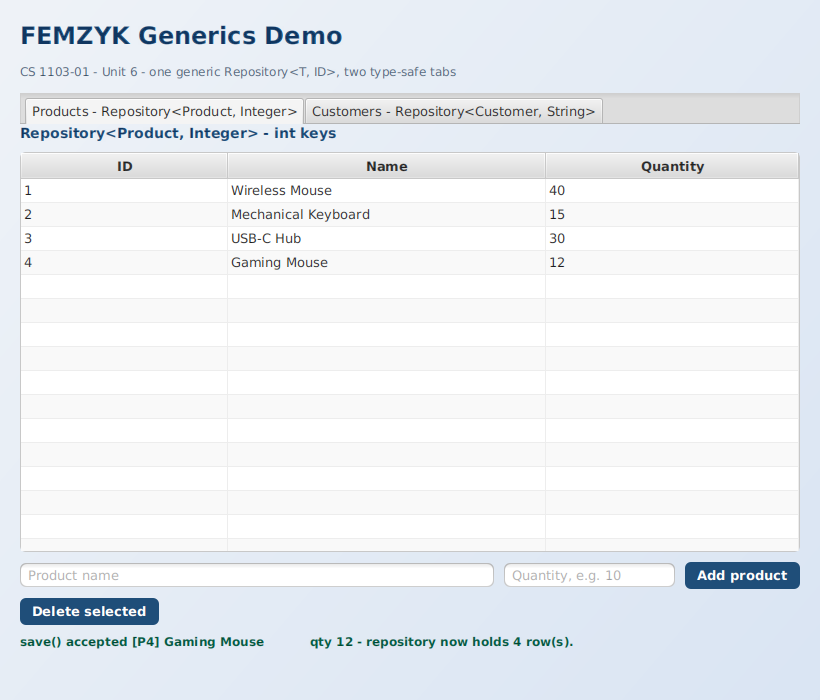
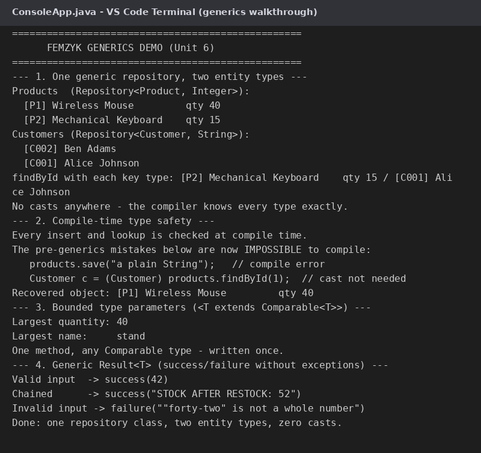

# FEMZYK Generics Demo

A companion demo for *CS 1103-01 – Unit 6 (Generics and the Collection Framework)*, built
to the same standard as the other FEMZYK projects: **one generic repository class written
once, serving two completely different entity types** — plus a bounded generic method and
a generic `Result` type — with a styled **JavaFX front end** and a **console walkthrough**.

🔗 **Repository:** https://github.com/FEMZYKENTLTD/FEMZYK-GenericRepositoryDemo



## 🧬 What it demonstrates

| Concept | Where | How |
|---------|-------|-----|
| **Generic class with two type parameters** | `Repository<T, ID>` / `InMemoryRepository<T, ID>` | One class serves `Repository<Product, Integer>` (int keys) *and* `Repository<Customer, String>` (String keys) — written once, zero casts |
| **Type safety at compile time** | everywhere | `products.save("a String")` cannot compile; retrieved objects need no casts (pre-generics code needed both) |
| **Type-safe collections** | `InMemoryRepository` internals | A `HashMap<ID, T>` with `ArrayList<T>` views — the same pattern the Collection Framework uses (Eck, 2022, Chapter 10) |
| **Bounded type parameters** | `ConsoleApp.maxOf` | One `<T extends Comparable<T>>` method finds the maximum of Integers and Strings alike |
| **Generic methods + inheritance** | `Result<T>` | A success/failure container with a generic `map()` that chains transformations while keeping errors |

## 🧱 Project layout

```
FEMZYK-GenericRepositoryDemo/
├── pom.xml                                            Maven build file (JavaFX + plugins)
├── docs/                                              Screenshots used by this README
└── src
    ├── main/java/com/femzyk/genericsdemo
    │   ├── core/Repository.java                       Generic data-access interface <T, ID>
    │   ├── core/InMemoryRepository.java               One generic implementation for every type
    │   ├── core/Result.java                           Generic success/failure container
    │   ├── core/Product.java                          Entity with an int id
    │   ├── core/Customer.java                         Entity with a String id (same repository!)
    │   ├── console/ConsoleApp.java                    Four-part generics walkthrough
    │   └── gui
    │       ├── Launcher.java                          Entry point of the JavaFX front end
    │       └── GenericsFxApp.java                     Two tabs = two type instantiations of one class
    ├── main/resources/com/femzyk/genericsdemo/gui
    │   └── styles.css                                 JavaFX stylesheet
    └── test/java/com/femzyk/genericsdemo/gui
        └── SnapshotRunner.java                        Dev utility that captures the GUI screenshot
```

## ✅ Requirements

- **JDK 17 or newer** (built and tested on JDK 25 with JavaFX 26)
- **Maven 3.8+**
- VS Code users: the **Extension Pack for Java** extension

## 🚀 Build and run

```bash
# 1. compile and package (clean build: no errors, no warnings)
mvn clean package

# 2. run the console walkthrough
java -cp target/femzyk-generics-demo-1.0.0.jar com.femzyk.genericsdemo.console.ConsoleApp

# 3. run the JavaFX front end
mvn javafx:run
```

In VS Code: open the folder with the **Extension Pack for Java** installed, then run
`Launcher.java` (GUI) or `ConsoleApp.java` (console) with **F5**.

Sample console output from a real run:

```
--- 1. One generic repository, two entity types ---
Products  (Repository<Product, Integer>):
  [P1] Wireless Mouse         qty 40
Customers (Repository<Customer, String>):
  [C001] Alice Johnson
No casts anywhere - the compiler knows every type exactly.

--- 3. Bounded type parameters (<T extends Comparable<T>>) ---
Largest quantity: 40
Largest name:     stand
One method, any Comparable type - written once.
```



## 📚 Reading

- Eck, D. J. (2022). *Introduction to programming using Java: Version 9, JavaFX edition* — Chapter 10, especially Section 10.5 "Writing Generic Classes and Methods": https://math.hws.edu/javanotes/c10/
- Divertitto, A. (2022, August 18). *Java generics: how to use angled brackets in practice*. CodeGym: https://codegym.cc/groups/posts/generics-in-java
- Kumar, A. (2023, April 18). *Mastering generics in Java: A comprehensive guide for Java developers*: https://techthoughtsexplorer.hashnode.dev/mastering-generics-in-java-a-comprehensive-guide-for-java-developers

## Academic context

Course demo for **CS 1103-01 – AY2027-T1, Unit 6 Discussion**
(University of the People). Built with Maven and JavaFX; compiled with a clean
`BUILD SUCCESS` (no errors, no warnings).
